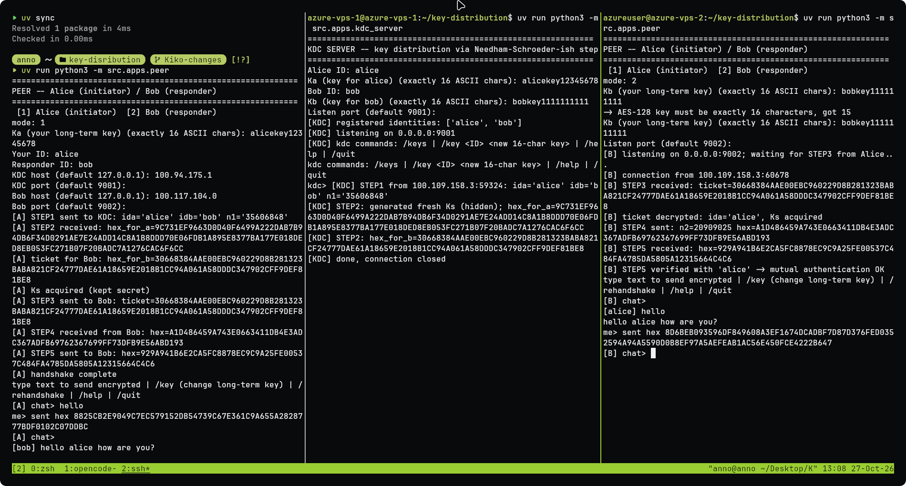

<div align="center">
<div data-importer="image" align="center">
  
</div>

<h2> Key Distribution : KDC </h2>




</div>

## 🫥 Project Introduction

An interactive key distribution and encrypted chat project written from scratch
in **Rust**. A **Key Distribution Center (KDC)** distributes a shared session key
to **Alice** and **Bob**, who then use it for two-way AES-128-encrypted chat over
TCP.

The project demonstrates key distribution, nonce-based authentication, and a
manual AES implementation across three computers with different IP addresses.
AES-128, CBC, and PKCS#7 are implemented in this repository; no cryptography
crate is used.

## 📝 Project Overview and Features

### Participants

| Participant | Role |
|---|---|
| KDC | Stores the long-term keys `Ka` and `Kb` and generates a fresh session key `Ks` for each handshake. |
| Alice | Initiates the handshake, obtains `Ks`, and forwards Bob's encrypted ticket. |
| Bob | Receives the ticket and completes the challenge-response exchange with Alice. |

Alice and Bob can both send and receive chat messages after the handshake.

### Features

- **Manual AES-128:** compile-time S-box generation, key expansion, encryption,
  and decryption implemented in Rust.
- **CBC mode:** random initialization vectors (IVs) and PKCS#7 padding.
- **Five-step key distribution:** a Needham–Schroeder-style protocol using tickets
  and nonces.
- **Full-screen TUI:** a `ratatui` + `crossterm` interface with setup forms, a
  live protocol log, a chat pane, scrollback, and a key-rotation modal. The
  line-based interface remains available with `--plain`.
- **Typed protocol:** newline-delimited JSON messages (`serde`) instead of ad-hoc
  delimited text.
- **Two-way communication:** a background reader thread processes incoming
  messages while the user types in either interface.
- **Inter-device networking:** KDC, Alice, and Bob can run on separate machines
  over TCP/IP.
- **Consistent formats:** keys and plaintext use ASCII; ciphertext uses uppercase
  hexadecimal.
- **Interactive key updates:** change long-term keys and request a fresh session
  key without restarting.
- **One binary, three roles:** `kdc`, `peer`, `alice`, and `bob` subcommands.
- **Protocol logging:** inspect handshake steps and outgoing chat ciphertext in the
  TUI log or plain terminal.

### Distribution protocol

The exchange follows the project's [distribution schema](schema-distribution.jpg):

```text
1. A → KDC : IDA || IDB || N1
2. KDC → A : E(Ka, [Ks || IDA || IDB || N1]) || E(Kb, [Ks || IDA])
3. A → B   : E(Kb, [Ks || IDA])                       (the ticket)
4. B → A   : E(Ks, N2)
5. A → B   : E(Ks, f(N2))                             (f(N2) = N2 + 1)
```

`Ka` and `Kb` are the long-term keys shared by each peer with the KDC. `Ks` is a
fresh 16-character ASCII session key. `N1` and `N2` are 8-digit nonces, and `E`
denotes AES-128-CBC encryption with a random IV prepended to the ciphertext.
Alice verifies the nonce and identities in step 2; steps 4–5 perform a
challenge-response exchange using `Ks`.

#### Wire format

Every transport line is one JSON object (NDJSON) encoded as UTF-8, terminated by
`\n`, with a 64 KiB line guard:

```json
{"type":"step1","initiator":"alice","responder":"bob","nonce":"84671352"}
{"type":"step2","for_initiator":"<HEX>","ticket":"<HEX>"}
{"type":"step3","ticket":"<HEX>"}
{"type":"step4","ciphertext":"<HEX>"}
{"type":"step5","ciphertext":"<HEX>"}
{"type":"msg","ciphertext":"<HEX>"}
{"type":"bye"}
{"type":"error","message":"unknown identity: \"carol\""}
```

Encrypted payloads are uppercase hex strings containing the 16-byte IV followed
by the ciphertext. The decrypted plaintext keeps the classic ASCII layout
`Ks|IDA|IDB|N1` and `Ks|IDA`. Identities reject empty values, control
characters, and `|` so the inner payload stays unambiguous. Lowercase hex is
accepted on input and normalised to uppercase.

## ⛏️ Tech Stack, APIs, and Other Resources

| Technology / resource | Purpose |
|---|---|
| Rust 1.88+ (edition 2024) | Runtime and language edition. |
| Cargo | Build, test, and run the single binary. |
| `std::net` | TCP connections between the KDC and peers. |
| `std::thread` / `std::sync` | Background accept, receiver, and shared state. |
| `clap` | Subcommand CLI (`kdc`, `peer`, `alice`, `bob`). |
| `serde` / `serde_json` | Typed NDJSON messages. |
| `rand` | OS-seeded randomness for session keys, nonces, and IVs. |
| `thiserror` | Typed error enums per layer. |
| `ctrlc` | Graceful interrupt message in plain mode. |
| `ratatui` + `crossterm` | Full-screen terminal UI, layout, input, and rendering. |
| [Distribution schema](schema-distribution.jpg) | Reference diagram for the key distribution exchange. |

There are no external API services. No third-party crypto library is used: AES,
CBC, and PKCS#7 live in `src/crypto/`.

### Project structure

```text
key-distribution/
├── Cargo.toml
├── README.md
├── LICENSE
├── schema-distribution.jpg
├── src/
│   ├── main.rs              # CLI: kdc | peer [--role alice|bob] | alice | bob
│   ├── lib.rs
│   ├── error.rs             # top-level AppError
│   ├── rng.rs               # alphabet sampling for keys/nonces
│   ├── crypto/
│   │   ├── tables.rs        # compile-time S-box, inverse S-box, Rcon
│   │   ├── aes.rs           # AES-128 key expansion and block operations
│   │   ├── modes.rs         # CBC, random IVs, PKCS#7 padding
│   │   └── codec.rs         # ASCII / bytes / uppercase hex, Key and Hex types
│   ├── protocol/
│   │   ├── messages.rs      # typed NDJSON message enum and validation
│   │   ├── kdc_logic.rs     # session key generation and KDC response
│   │   └── handshake.rs     # nonces, tickets, challenge-response
│   ├── net/
│   │   └── framing.rs       # buffered NDJSON line framing over TCP
│   ├── tui/
│   │   ├── mod.rs           # TUI entry points
│   │   ├── runtime.rs       # terminal lifecycle + event loop
│   │   ├── widgets.rs       # ASCII text field, wrapping, layout helpers
│   │   ├── log.rs           # scrollable protocol/chat log
│   │   ├── setup.rs         # setup forms with validation
│   │   ├── chat.rs          # chat pane, history, key-rotation modal
│   │   ├── kdc.rs           # KDC dashboard
│   │   └── peer.rs          # Alice/Bob screens and role selection
│   └── apps/
│       ├── common.rs        # plain-mode input validation
│       ├── kdc_server.rs    # KDC entry point and menu
│       ├── peer.rs          # Alice / Bob entry points and handshakes
│       └── chat.rs          # plain-mode two-way chat
└── tests/                   # crypto, protocol, framing, and end-to-end tests
```

## 🧑‍💻 Getting Started: Setup and Running Instructions

### Prerequisites and setup

Install a Rust toolchain **1.88 or newer** (for edition 2024 and the APIs used
by the crypto test suite) and Git. On each machine, clone the project and build it:

```bash
git clone https://github.com/AbdillahHamzahAli/key-distribution.git
cd key-distribution
cargo build --release
```

Run all commands below from the project root. For three-machine testing, use the
actual **KDC IP** and **Bob IP** when Alice connects. Allow TCP traffic to the
KDC's port **9001** and Bob's port **9002**. Both listeners bind to `0.0.0.0`.
For local testing, open three terminals and use `127.0.0.1` for both hosts.

You can either use `cargo run --release -- <command>` or the built binary at
`target/release/key-distribution`.

### Interface selection

The binary automatically opens the full-screen TUI when both stdin and stdout are
terminals. Use the line-based workflow explicitly with `--plain`, or force the TUI
with `--tui`:

```bash
cargo run --release -- kdc            # TUI on a normal terminal
cargo run --release -- --plain kdc    # line-based prompts and menu
```

In the TUI, every setup form is prefilled with the local defaults below. Use
`Tab` / `↑` `↓` to move, edit values normally, and press `Enter` to start.
`Esc` quits. `peer` without `--role` shows a role-selection screen.

### 1. Start the KDC

On the KDC machine:

```bash
cargo run --release -- kdc
```

Accept these defaults in the TUI form (or enter the same values in `--plain`
mode). Both long-term keys must contain exactly **16 ASCII characters**:

```text
Alice ID: alice
Ka (key for alice): AliceKey12345678
Bob ID: bob
Kb (key for bob): BobKey1111111111
Listen port (default 9001): 9001
```

### 2. Start Bob as the responder

On Bob's machine, start the peer before Alice connects:

```bash
cargo run --release -- peer --role bob
# or: cargo run --release -- bob
# add --plain for the line-based prompts
```

```text
Kb (your long-term key): BobKey1111111111
Listen port (default 9002): 9002
```

Bob waits for Alice's ticket. His `Kb` must match the key registered for `bob` at
the KDC.

### 3. Start Alice as the initiator

On Alice's machine:

```bash
cargo run --release -- peer --role alice
# or: cargo run --release -- alice
# add --plain for the line-based prompts
```

```text
Ka (your long-term key): AliceKey12345678
Your ID: alice
Responder ID: bob
KDC host (default 127.0.0.1): <KDC-IP>
KDC port (default 9001): 9001
Bob host (default 127.0.0.1): <BOB-IP>
Bob port (default 9002): 9002
```

Replace `<KDC-IP>` and `<BOB-IP>` with the corresponding machines' IP addresses.
Alice's `Ka` and both IDs must match the KDC registration.

`cargo run --release -- peer` without `--role` asks for Alice or Bob, matching the
older workflow; in the TUI this is a full-screen selection screen.

Alice runs the five-step handshake automatically. After it completes, both peers
can type ASCII messages. The sender sees outgoing ciphertext in hex; the receiver
sees decrypted text, such as `[alice] Hello Bob`.

### Chat commands

| Command | Effect |
|---|---|
| Any ASCII text | Encrypt and send a chat message using `Ks`. |
| `/key` | Change the local long-term key (`Ka` or `Kb`) for the next handshake. |
| `/rehandshake` | End the current chat connection and begin another handshake; Alice initiates the exchange and Bob's listener accepts it. |
| `/help` or `/menu` | Show chat commands. |
| `/quit` | Send `BYE` and exit the local peer. |

In the TUI, use `PgUp` / `PgDn` to scroll the conversation, `↑` / `↓` to recall
message history, and `Esc` to cancel the `/key` modal. `Ctrl+C` quits. Bob keeps
his listener ready after a chat ends, so if Alice rehandshakes while Bob is still
on the old chat screen, Bob automatically accepts the new connection and replaces
the chat pane. In `--plain` mode, press Enter when prompted after a disconnect;
Alice can choose `r` to reconnect and Bob returns to listening.

### Change keys without restarting

1. On the peer whose key will change, enter `/key` and provide a new 16-character
   ASCII key. The TUI opens a masked modal; `--plain` prompts on the terminal.
2. On the KDC console, update the same identity before the next handshake:

   ```text
   /key alice NewAliceKey12345
   ```

3. On Alice's console, run `/rehandshake` to obtain a fresh `Ks`. Bob is either
   waiting or automatically accepts the new handshake. If Bob initiated the
   change, run `/rehandshake` on Bob first, then on Alice.

Changing `Ka` or `Kb` affects the next handshake; the current chat continues to
use its existing `Ks`. The peer and KDC must use matching long-term keys.

The KDC also accepts `/keys` to display registered identities and their keys,
`/help` for commands, and `/quit` to stop the server. Handshake logs keep `Ks`
hidden.

### Run tests

```bash
cargo test
```

The suite covers:

- AES block vectors (FIPS-197 Appendix B and C.1), key expansion, and transforms.
- CBC, random IVs, PKCS#7 padding, and text wrappers.
- ASCII/hex conversion and the `Key` / `Hex` newtypes.
- NDJSON message serialization and validation.
- Ticket parsing, nonce checks, and challenge-response verification.
- Framed TCP reads, fragmented arrivals, clean closes, and oversized lines.
- TUI text-field editing, wrapping, setup validation, command parsing, and
  `TestBackend` rendering.
- An end-to-end KDC → Alice → Bob handshake followed by two-way encrypted chat.

Optional quality gates:

```bash
cargo fmt --check
cargo clippy --all-targets -- -D warnings
```

## 🔥 Conclusion and License

This project brings manual AES-128, KDC-based session key distribution, and
interactive TCP chat together as a practical learning exercise. Run the three
participants to explore the handshake, exchange encrypted messages, and rotate
keys while the programs remain running.

Licensed under the **MIT License**. See [LICENSE](LICENSE) for the full terms.
