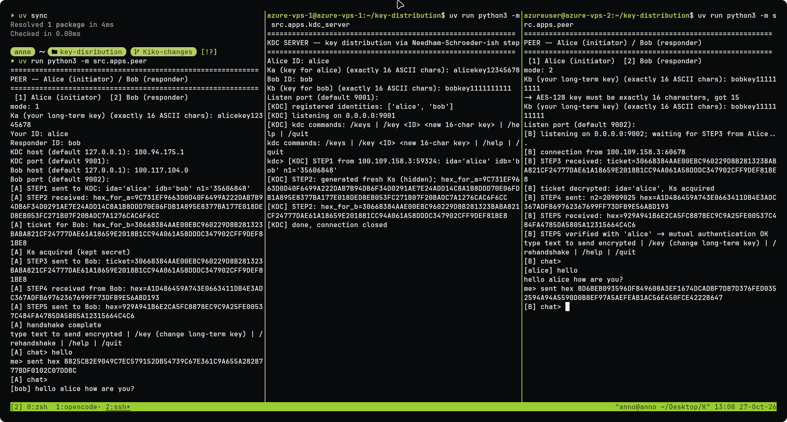

<div align="center">
<div data-importer="image" align="center">
  
</div>

<h2> Key Distribution : KDC </h2>




</div>

## 🫥 Project Introduction

An interactive key distribution and encrypted chat project built from scratch in
Python. A **Key Distribution Center (KDC)** distributes a shared session key to
**Alice** and **Bob**, who then use it for two-way AES-128-encrypted chat over TCP.

The project demonstrates key distribution, nonce-based authentication, and manual
AES encryption across three computers with different IP addresses. It uses only
the Python standard library, with no third-party cryptography libraries.

## 📝 Project Overview and Features

### Participants

| Participant | Role |
|---|---|
| KDC | Stores the long-term keys `Ka` and `Kb` and generates a fresh session key `Ks` for each handshake. |
| Alice | Initiates the handshake, obtains `Ks`, and forwards Bob's encrypted ticket. |
| Bob | Receives the ticket and completes the challenge-response exchange with Alice. |

Alice and Bob can both send and receive chat messages after the handshake.

### Features

- **Manual AES-128:** key expansion, encryption, and decryption implemented in Python.
- **CBC mode:** random initialization vectors (IVs) and PKCS#7 padding.
- **Five-step key distribution:** a Needham–Schroeder-style protocol using tickets and nonces.
- **Two-way communication:** a receiver thread processes incoming messages while the user types.
- **Inter-device networking:** KDC, Alice, and Bob can run on separate machines over TCP/IP.
- **Consistent formats:** keys and plaintext use ASCII; ciphertext uses uppercase hexadecimal.
- **Interactive key updates:** change long-term keys and request a fresh session key without restarting.
- **Protocol logging:** inspect handshake steps and outgoing chat ciphertext in the terminal.

### Distribution protocol

The exchange follows the project's [distribution schema](schema-distribution.jpg):

```text
1. A → KDC : IDA || IDB || N1
2. KDC → A : E(Ka, [Ks || IDA || IDB || N1]) || E(Kb, [Ks || IDA])
3. A → B   : E(Kb, [Ks || IDA])                       (the ticket)
4. B → A   : E(Ks, N2)
5. A → B   : E(Ks, f(N2))                             (f(N2) = N2 + 1)
```

`Ka` and `Kb` are the long-term keys shared by each peer with the KDC. `Ks` is a
fresh 16-character ASCII session key. `N1` and `N2` are nonces, and `E` denotes
AES-CBC encryption. Alice verifies the nonce and identities in step 2; steps 4–5
perform a challenge-response exchange using `Ks`.

Messages are newline-framed ASCII strings over TCP, such as
`STEP1|alice|bob|84671352` and `STEP2|<hexA>|<hexB>`. Encrypted payloads contain the
IV followed by ciphertext, encoded together as hex.

## ⛏️ Tech Stack, APIs, and Other Resources

| Technology / resource | Purpose |
|---|---|
| Python >= 3.14 | Runtime required by [pyproject.toml](pyproject.toml). |
| `uv` | Environment setup and module execution. |
| `socket` | TCP connections between the KDC and peers. |
| `threading` | Background connection handling and chat reception. |
| `secrets` | Random session keys, nonces, and IVs. |
| `unittest` | Automated tests, including FIPS-197 AES block vectors. |
| [Distribution schema](schema-distribution.jpg) | Reference diagram for the key distribution exchange. |

There are no external API services or third-party runtime dependencies. The
network protocol uses Python's socket API directly.

### Project structure

```text
key-distribution/
├── pyproject.toml
├── README.md
├── LICENSE
├── schema-distribution.jpg
├── src/
│   ├── crypto/
│   │   ├── tables.py        # S-box, inverse S-box, Rcon
│   │   ├── aes.py           # AES-128 key expansion and block operations
│   │   ├── modes.py         # CBC, random IVs, PKCS#7 padding
│   │   └── codec.py         # ASCII / bytes / hex conversion
│   ├── protocol/
│   │   ├── messages.py      # Message serialization and parsing
│   │   ├── kdc_logic.py     # Session key generation and KDC response
│   │   └── handshake.py     # Nonces, tickets, challenge-response
│   ├── net/
│   │   └── framing.py       # Newline-based TCP framing
│   └── apps/
│       ├── common.py        # Interactive input validation
│       ├── kdc_server.py    # KDC entry point
│       ├── peer.py          # Alice / Bob entry point
│       └── chat.py          # Interactive two-way chat
└── tests/                  # Crypto, protocol, and networking tests
```

## 🧑‍💻 Getting Started: Setup and Running Instructions

### Prerequisites and setup

Install Python **3.14 or newer**, `uv`, and Git. On each machine, clone the project
and prepare the environment:

```bash
git clone https://github.com/AbdillahHamzahAli/key-distribution.git
cd key-distribution
uv sync
```

Run all commands below from the project root. The project sets
`[tool.uv] package = false` and runs directly as `src.apps.*` modules.

For three-machine testing, use the actual **KDC IP** and **Bob IP** when Alice
connects. Allow TCP traffic to the KDC's port **9001** and Bob's port **9002**.
Both listeners bind to `0.0.0.0`. For local testing, open three terminals and use
`127.0.0.1` for both hosts.

### 1. Start the KDC

On the KDC machine:

```bash
uv run python3 -m src.apps.kdc_server
```

Enter these example values when prompted. Both long-term keys must contain
exactly **16 ASCII characters**:

```text
Alice ID: alice
Ka (key for alice): AliceKey12345678
Bob ID: bob
Kb (key for bob): BobKey1111111111
Listen port: 9001
```

### 2. Start Bob as the responder

On Bob's machine, start the peer before Alice connects:

```bash
uv run python3 -m src.apps.peer
```

```text
mode: 2
Kb (your long-term key): BobKey1111111111
Listen port: 9002
```

Bob waits for Alice's ticket. His `Kb` must match the key registered for `bob` at
the KDC.

### 3. Start Alice as the initiator

On Alice's machine:

```bash
uv run python3 -m src.apps.peer
```

```text
mode: 1
Ka (your long-term key): AliceKey12345678
Your ID: alice
Responder ID: bob
KDC host: <KDC-IP>
KDC port: 9001
Bob host: <BOB-IP>
Bob port: 9002
```

Replace `<KDC-IP>` and `<BOB-IP>` with the corresponding machines' IP addresses.
Alice's `Ka` and both IDs must match the KDC registration.

Alice runs the five-step handshake automatically. After it completes, both peers
can type ASCII messages. The sender sees outgoing ciphertext in hex; the receiver
sees decrypted text, such as `[alice] Hello Bob`.

### Chat commands

| Command | Effect |
|---|---|
| Any ASCII text | Encrypt and send a chat message using `Ks`. |
| `/key` | Change the local long-term key (`Ka` or `Kb`) for the next handshake. |
| `/rehandshake` | End the current chat connection and begin another handshake; Alice initiates the exchange and Bob waits for it. |
| `/help` or `/menu` | Show chat commands. |
| `/quit` | Send `BYE` and exit the local peer. |

When a peer disconnects, press Enter if prompted so the local input loop can
continue. Alice can choose `r` to reconnect; Bob returns to listening.

### Change keys without restarting

1. On the peer whose key will change, enter `/key` and provide a new 16-character
   ASCII key. Empty input cancels the change.
2. On the KDC console, update the same identity before the next handshake:

   ```text
   /key alice NewAliceKey12345
   ```

3. On Alice's console, run `/rehandshake` to obtain a fresh `Ks`. On Bob's console,
   press Enter when the disconnection prompt appears so Bob can accept the new
   connection.

Changing `Ka` or `Kb` affects the next handshake; the current chat continues to
use its existing `Ks`. The peer and KDC must use matching long-term keys.

The KDC also accepts `/keys` to display registered identities and their keys,
`/help` for commands, and `/quit` to stop the server. Handshake logs keep `Ks`
hidden.

### Run tests

```bash
uv run python3 -m unittest discover -s tests -v
```

The suite covers AES block vectors and key expansion, CBC and padding, ASCII/hex
conversion, protocol messages, ticket and nonce verification, and socket framing.

## 🔥 Conclusion and License

This project brings manual AES-128, KDC-based session key distribution, and
interactive TCP chat together as a practical learning exercise. Run the three
participants to explore the handshake, exchange encrypted messages, and rotate
keys while the programs remain running.

Licensed under the **MIT License**. See [LICENSE](LICENSE) for the full terms.
